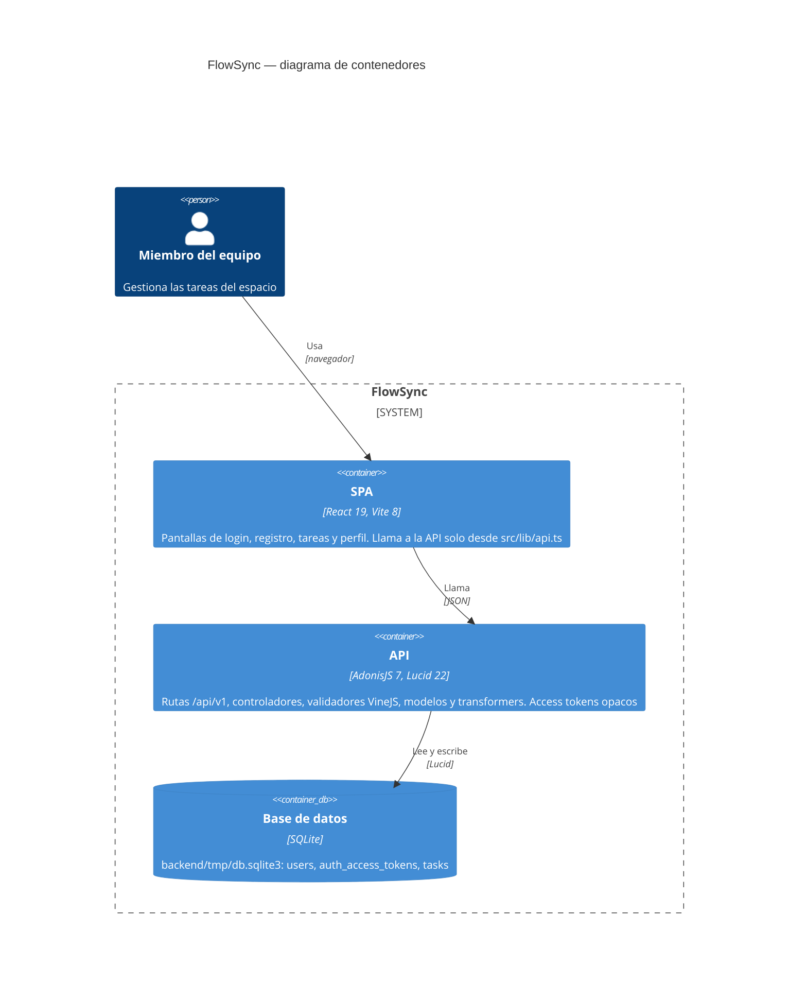

# Arquitectura de FlowSync

El diagrama muestra los contenedores de FlowSync según el modelo C4: la SPA de React que usa el equipo, la API de AdonisJS que expone `/api/v1` y la base de datos SQLite donde viven las cuentas, los tokens de acceso y las tareas. En tiempo de ejecución no hay ningún sistema externo, así que no se dibuja ninguno.

