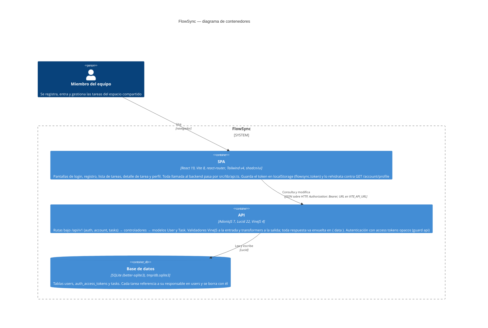

# Arquitectura de FlowSync

El diagrama muestra los contenedores de FlowSync según el modelo C4: la SPA de React que ve el equipo, la API de AdonisJS que expone `/api/v1` y la base de datos SQLite donde viven las cuentas, los tokens de acceso y las tareas. Lo que cada caja contiene y cada flecha dice se ha comprobado leyendo el código; no hay ningún sistema externo porque el repositorio no integra ninguno.

